# SkyHop architecture


SkyHop is a 3D tap-to-fly arcade game: tap to flap, thread the bird through pipes, clear ten levels that each get harder
(or play endless). One TypeScript code base runs in any modern browser and, wrapped by Capacitor, as an offline Android
app. Every picture and sound is generated in code, so there are no art or audio files.

This document explains how it is built and why. For how to run it, play it and install the APK, see the
[README](README.md). The original stack decision is recorded in
[docs/ADR-0001-stack-and-visual-direction.md](docs/ADR-0001-stack-and-visual-direction.md).

**Contents:**
[1. Big picture](#1-big-picture) ·
[2. Layers and dependency rules](#2-layers-and-dependency-rules) ·
[3. The frame loop](#3-the-frame-loop) ·
[4. Game rules (core)](#4-game-rules-core) ·
[5. Input](#5-input) ·
[6. Presentation](#6-presentation-screens-sound-and-effects) ·
[7. 3D rendering](#7-3d-rendering) ·
[8. Persistence](#8-persistence) ·
[9. UI and accessibility](#9-ui-and-accessibility) ·
[10. Audio](#10-audio) ·
[11. Design system](#11-design-system) ·
[12. Build, Android and release](#12-build-android-and-release) ·
[13. Testing](#13-testing) ·
[14. Decisions and trade-offs](#14-decisions-and-trade-offs) ·
[15. Extending the game](#15-extending-the-game) ·
[16. Known limits](#16-known-limits)

---

## 1. Big picture

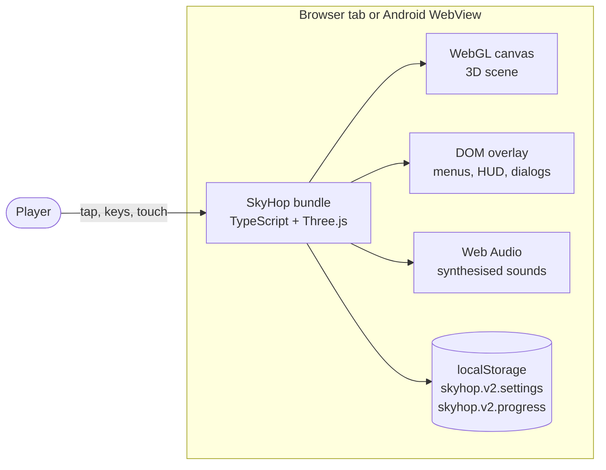

| Concern | Choice | Why |
|---|---|---|
| Language | TypeScript, strict, `noUncheckedIndexedAccess` | The rules engine is easy to get subtly wrong; the compiler catches a lot of it. |
| 3D | Three.js (WebGL) | The owner asked for a real 3D bird. Phaser was removed (see the ADR). |
| Bundler and tests | Vite 8, Vitest 5 | Fast feedback; one config for app and tests. |
| UI | Plain DOM built with `createElement`, no `innerHTML`, no framework | Small, accessible by construction, nothing to parse as HTML. |
| Sound | Web Audio synthesis | No audio files to license or download. |
| Native | Capacitor 8 (Android) | Same web build inside a WebView, fully offline. |
| Font | Fredoka (SIL OFL), self-hosted | No network request, no licence doubt. |

Three ideas shape everything else:

1. **Rules are separate from pixels.** `src/core` is pure TypeScript with no DOM and no Three.js. It runs identically in
   unit tests, in the autopilot fairness test and in the real game.
2. **Fixed-step physics.** The simulation always advances in 1/120 s steps, and the renderer interpolates, so speed is the
   same on 30, 60, 120 and 144 Hz screens.
3. **The renderer is behind a small interface.** `GameApp` talks to a `WorldPort`, so tests substitute a fake and the
   renderer could be replaced by re-implementing one class.

## 2. Layers and dependency rules

```mermaid
flowchart TB
    main["src/main.ts<br/>creates the app"] --> GameApp

    subgraph app["src/app: wiring, the only layer that knows everything"]
        GameApp["GameApp<br/>frame loop and UI actions"]
        Presenter["PhasePresenter<br/>phases and events to screens, sound, effects"]
        Profile["Profile<br/>settings, progress, unlocks"]
        Loop["GameLoop<br/>requestAnimationFrame"]
        Governor["PerformanceGovernor<br/>adaptive resolution"]
        Scroll["ScrollTracker"]
        Scheduler["Scheduler<br/>delayed callbacks in game time"]
    end

    subgraph core["src/core: pure rules, no DOM, no Three.js"]
        Session["GameSession"]
        Phase["PhaseMachine"]
        Bird["BirdBody"]
        Pipes["PipeField"]
        Collision["collision"]
        Levels["levels"]
        Stepper["FixedStepper"]
        Rng["rng"]
        Config["config"]
    end

    subgraph render["src/render: Three.js scene"]
        World["WorldView"]
        Stage["Stage<br/>renderer and camera"]
        Env["Environment<br/>sky, clouds, terrain, light"]
        BirdModel["BirdModel"]
        PipeLayer["PipeLayer"]
        Fx["Particles and Rings"]
    end

    subgraph ui["src/ui: DOM overlays"]
        Ui["Ui"]
        Hud["Hud"]
        Screens["screens and dialogs"]
    end

    subgraph io["input, audio, storage"]
        Input["InputController"]
        Sfx["Sfx"]
        Repo["Repository"]
    end

    GameApp --> Session
    GameApp --> Stepper
    GameApp --> Presenter
    GameApp --> Profile
    GameApp --> Loop
    GameApp --> Governor
    GameApp --> Scroll
    GameApp --> Scheduler
    GameApp -->|"WorldPort interface"| World
    GameApp --> Ui
    GameApp --> Input
    GameApp --> Sfx
    Presenter --> Ui
    Presenter --> Sfx
    Presenter -->|"WorldPort interface"| World
    Profile --> Repo
    Session --> Phase
    Session --> Bird
    Session --> Pipes
    Session --> Collision
    Pipes --> Levels
    World --> Stage
    World --> Env
    World --> BirdModel
    World --> PipeLayer
    World --> Fx
    Ui --> Hud
    Ui --> Screens
```

**Dependency rules** (they keep the code testable, and the tests rely on them):

* `src/core` imports nothing from the other layers.
* `src/render` and `src/ui` may read core types and data (levels, skins, pipe shape) but never change game state.
* Only `src/app` imports everything and connects the parts. `src/main.ts` is the one place that builds real
  collaborators (`WorldView`, browser storage) and hands them in.
* Every browser capability reaches `GameApp` through an injected dependency (`AppDeps`): the world factory, storage,
  frame scheduler, sound, vibration, reload. That is how the app-level tests run without WebGL.

| Folder | Responsibility | Key files |
|---|---|---|
| `src/core/` | Game rules and numbers | `session.ts`, `phase.ts`, `bird.ts`, `pipes.ts`, `collision.ts`, `levels.ts`, `clock.ts`, `config.ts`, `rng.ts`, `skins.ts` |
| `src/app/` | Wiring, frame loop, adaptive quality | `GameApp.ts`, `presenter.ts`, `profile.ts`, `governor.ts`, `loop.ts`, `scroll.ts`, `scheduler.ts`, `ports.ts` |
| `src/render/` | The 3D world | `world.ts`, `stage.ts`, `environment.ts`, `sky.ts`, `clouds.ts`, `terrain.ts`, `birdModel.ts`, `birdParts.ts`, `pipeModels.ts`, `effects.ts`, `themeData.ts`, `palette.ts`, `spring.ts` |
| `src/ui/` | Everything drawn in the DOM | `ui.ts`, `hud.ts`, `screens.ts`, `dialogs.ts`, `widgets.ts`, `copy.ts`, `styles.css` |
| `src/input/` | Keyboard, mouse, touch, pen to three intents | `inputController.ts` |
| `src/audio/` | Synthesised sound effects | `sfx.ts` |
| `src/storage/` | Validated persistence | `repository.ts` |

## 3. The frame loop

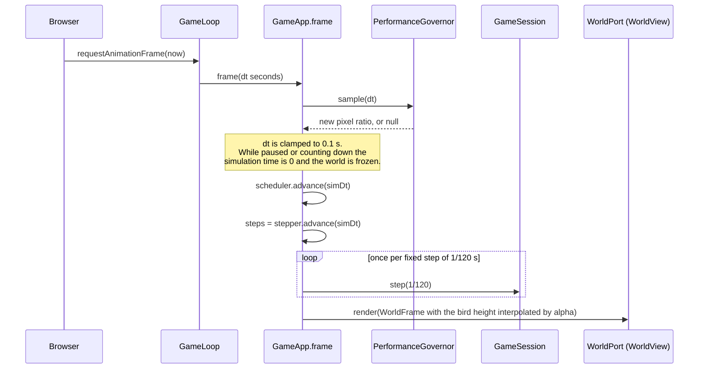

* `FixedStepper` turns a variable frame time into a whole number of fixed steps and keeps the leftover as `alpha`, which
  the renderer uses to interpolate the bird between two physics states. Long stalls (a hidden tab) are clamped, so the
  bird never teleports.
* The 3-2-1 countdown after resuming uses real frame time, so it keeps ticking while the world is frozen.
* `PerformanceGovernor` watches frame times. After a 1.2 s warm-up it measures over 1.5 s windows and, below 42 fps,
  steps the render resolution down (on a screen with device ratio 2: 2, then 1.5, then 1, then 0.75). It only ever steps
  down, which avoids visible flicker between resolutions.
* If the page is hidden or the window loses focus (`visibilitychange`, `blur`, which is also what happens when an Android
  app goes to the background), the game pauses itself.

## 4. Game rules (core)

### 4.1 Phases

`PhaseMachine` is a small table-driven state machine. An event that is not legal in the current phase is ignored, which is
what makes double taps and late timers harmless.

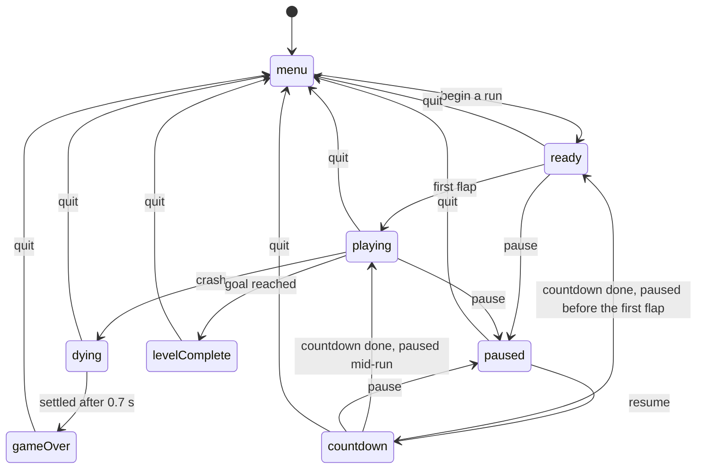

Starting a run (`GameSession.begin`) jumps straight to `ready` from any phase, which is how Try again, Next level, Replay
and Restart level all work.

### 4.2 One simulation step while playing

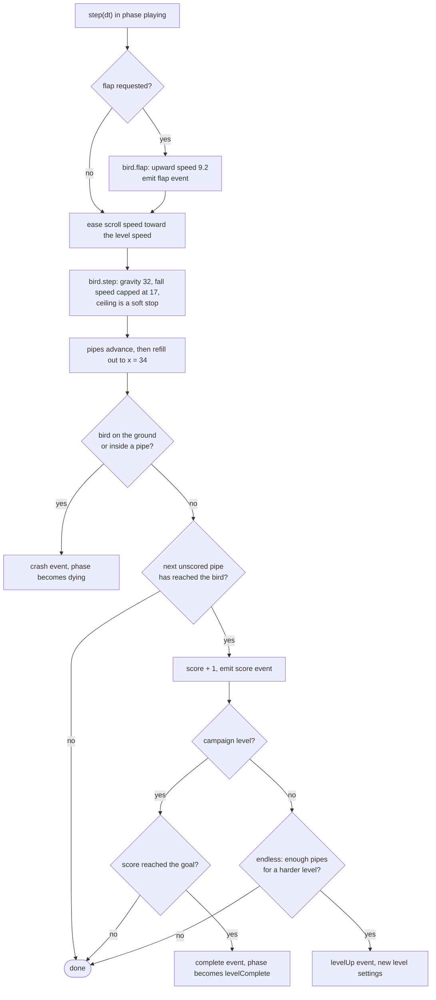

A flap request is stored and applied on the next fixed step, so a tap between two steps is never lost. The bird's hit
shape is a circle (radius 0.36 against a drawn radius of 0.5, a deliberately forgiving hitbox) tested against four
rectangles per pipe pair: body and wider cap, above and below the opening.

### 4.3 Levels and difficulty

Ten campaign levels come from one formula (with `i` the zero-based level index); endless mode walks the same curve, one
step every 6 pipes, then holds the last level.

| Quantity | Formula | Level 1 to level 10 |
|---|---|---|
| Pipes to clear | `min(24, 8 + 2i)` | 8 to 24 |
| Scroll speed (units/s) | `4.2 + 0.28i` | 4.20 to 6.72 |
| Gap height (units) | `4.6 - 0.18i` | 4.60 to 2.98 |
| Time between pipes (s) | `1.75 - 0.07i` | 1.75 to 1.12 |
| Largest vertical change between gaps | `2.2 + 0.45i` | 2.2 to 6.25 |
| Share of pipes that slide up and down | from level 5: `min(0.8, 0.3 + 0.1 (i - 4))` | 30% to 80% |
| Slide distance and rate | from level 5: `0.6 + 0.1 (i - 4)`, `1.1 + 0.1 (i - 4)` | grows each level |

Assist mode multiplies every gap by 1.25. The generated level table in the README is checked against this code by a test.

### 4.4 Fair pipe generation

Random layouts can be impossible, so `PipeField` limits how far each gap may move from the previous one by what a person
can actually do in the time between two pipes:

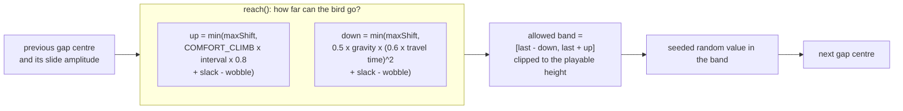

* **Climbing** is limited by how often a person can flap (`COMFORT_CLIMB` = 3 units per second).
* **Falling** is limited by gravity, because there is no downward thrust; the generator may use only 60% of the free-fall
  time (`FALL_COMFORT`) so the player has time to react.
* `slack` is the room inside the gap beyond the bird's hit circle; `wobble` is the combined slide amplitude of the two
  neighbouring pipes.

This rule was added after the autopilot test exposed a real defect: downward jumps had no cap. The fairness test now has
a simple bot clear every level on 60 seeds, in normal and assist mode (see [Testing](#13-testing)).

All randomness comes from a seeded generator (`rng.ts`), so any layout can be replayed exactly.

### 4.5 Physics constants

All of them live in `src/core/config.ts`; this is where to tune the feel.

| Constant | Value | Meaning |
|---|---|---|
| `PHYSICS.step` | 1/120 s | Fixed simulation step |
| `PHYSICS.gravity` | 32 units/s² | Downward acceleration |
| `PHYSICS.flapVelocity` | 9.2 units/s | Upward speed set by a flap |
| `PHYSICS.maxFallSpeed` | 17 units/s | Terminal velocity |
| `PHYSICS.maxFrameDelta` | 0.1 s | Longest frame the simulation accepts |
| `PHYSICS.settleDelay` | 0.7 s | Time on the ground before the game-over screen |
| `WORLD.hitRadius` | 0.36 | Bird hit circle (drawn radius is 0.5) |
| `WORLD.ceiling` | 14 | Top of the playable area |
| `WORLD.pipeWidth` / `capWidth` | 1.5 / 1.95 | Pipe body and cap |

One unit is roughly one bird-body diameter, +y is up, and the bird sits at x = 0 while the world scrolls past it.

## 5. Input

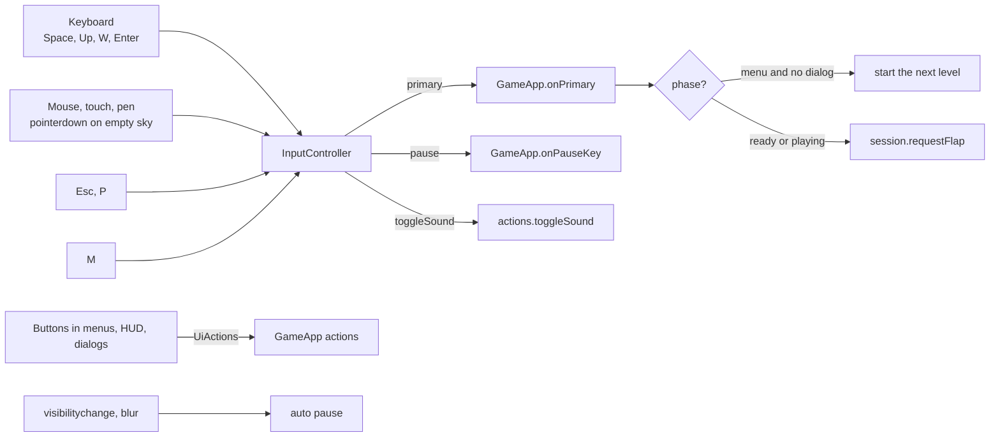

* Pointer, touch and pen all arrive as `pointerdown`, so there is one code path for every device.
* Taps and keys on interactive elements (buttons, switches, links, dialogs) are ignored by `InputController`, so using a
  control never also flaps the bird. The menu is built so that only the controls take pointer events; a tap anywhere else
  starts the game.
* `UiActions` is the whole surface between the screens and the app: `playLevel`, `playEndless`, `retry`, `nextLevel`,
  `toMenu`, `pause`, `resume`, `restartLevel`, `toggleSound`, `setSetting`, `resetProgress`, `reload`, `clicked`.

## 6. Presentation: screens, sound and effects

`PhasePresenter` is the only translator between game state and what the player sees and hears. It reacts to two streams:

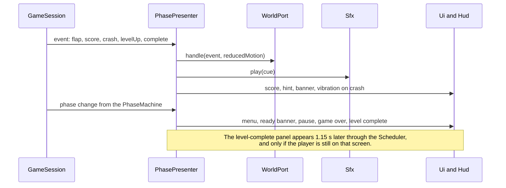

Why a presenter exists: the core must not know about screens, and the screens must not know about rules. Keeping the
mapping in one class means "what happens on a crash" (shake, particles, hit sound, optional vibration, hint cleared) is
readable in one place and testable with fakes.

The `Scheduler` runs delayed callbacks in *game* time, so a pending level-complete panel also waits while the game is
paused.

## 7. 3D rendering

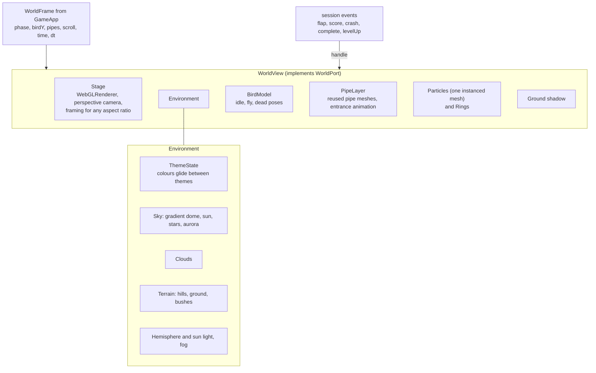

* **Camera framing** (`computeFraming`): chooses a camera distance that keeps the whole play column visible on a tall
  phone and on a wide monitor, and keeps the bird horizontally centred. The ground stays at the bottom in portrait and
  landscape. (Pipes now despawn further behind the bird, `WORLD.despawnX`, because a centred bird leaves more of the
  scene visible on its left.)
* **Bird**: a lit 3D model with a dark outline hull, built in code (`birdParts.ts`). Wing flapping follows a hand-shaped
  curve, and a damped spring gives squash and stretch. Four skins swap the palette.
* **Pipes**: a reusable set of mesh groups (created on demand, reused every frame) that share geometry and two materials,
  with a stylised sheen stripe. Pipes that slide up and down use the second material, tinted orange with a gentle
  pulsing glow, which is the visual cue (explained in words on level 5). They grow in with a rolling entrance.
* **Themes**: six sky themes (meadow, noon, golden hour, dusk, night, aurora). Colours and light values glide toward the
  target theme, so a level change feels like time passing.
* **Effects**: one instanced mesh draws every puff, feather and confetti piece. Reduced motion shrinks bursts and removes
  screen shake.
* **Cheap on purpose**: merged geometry, no shadow maps, no post-processing, pixel ratio capped at 2, plus the adaptive
  resolution governor.
* **Context loss**: if the GPU context is lost, the loop stops and a reload screen appears; if it is restored, the game
  carries on.

## 8. Persistence

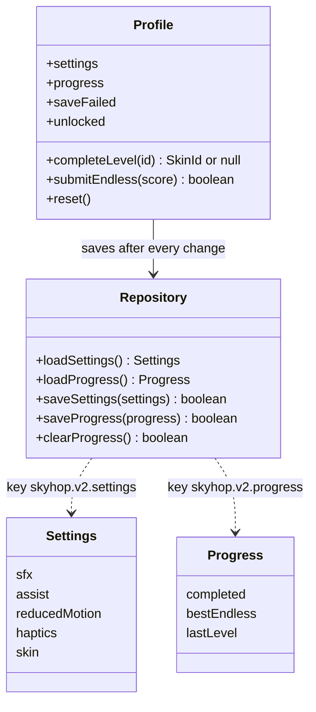

* **Every read is validated.** Stored JSON is parsed inside `try/catch`, then each field is type-checked and range-checked
  (`sanitizeSettings`, `sanitizeProgress`); anything wrong falls back to a default. Corrupted or hand-edited data cannot
  crash or unlock the game.
* **Writes never throw.** A failed write (storage full or blocked) returns `false`, `Profile.saveFailed` is set, and the
  game keeps playing. If storage is blocked entirely (a private window, strict privacy settings) the menu says so.
* **Unlocking:** a level is playable once the one before it is completed. Birds unlock when levels 3, 6 and 10 are
  completed (Azure, Mint, Sunrise Gold); Coral is always available. A saved skin that is no longer unlocked reverts to
  Coral.
* Nothing leaves the device: there is no network call, analytics, account or ad.

## 9. UI and accessibility

`Ui` owns every piece of DOM on top of the canvas: the `Hud`, a base layer for the menu and a modal layer for dialogs. The
screens (`buildMenu`, `buildPause`, `buildGameOver`, `buildLevelComplete`, `buildError`, `buildLevels`, `buildSettings`)
are pure functions from a view model and the `UiActions` to a DOM element, which makes them easy to test in jsdom.

* All text lives in `copy.ts`, so wording is reviewed in one place.
* Text is inserted as text nodes, never parsed as HTML.
* Controls are real buttons, or `role="switch"` / `role="radio"`, at least 44 by 44 px, with a visible focus ring.
* Dialogs trap focus and return it to the opener on close; level and result changes are announced through an `aria-live`
  region; the canvas has a label.
* Reduce motion defaults from the system setting and can be changed in Settings; **Assist mode** widens gaps.
* Safe-area insets (`env(safe-area-inset-*)`) keep controls clear of notches and gesture bars.
* axe-core (WCAG 2.0 A/AA, 2.1 AA, 2.2 AA rules) runs on the menu, level select, settings, level-complete and game-over
  screens in the browser suite.

## 10. Audio

`Sfx` creates its audio context on the first user gesture (browsers require that), then plays short synthesised cues. A
failure to play disables sound instead of breaking the game.

| Cue | Sound |
|---|---|
| flap | Short rising sine with a faint air hiss |
| score | Two quick triangle notes, 880 Hz then 1318 Hz |
| hit | Noise burst plus a falling square wave |
| complete | Rising four-note arpeggio (C5, E5, G5, C6) |
| levelUp | Two triangle notes, 660 Hz then 990 Hz |
| click, tick, go | UI click; countdown tick; rising "go" |

## 11. Design system

The visual direction is **sticker arcade**: a soft, lit 3D world whose dark-navy outline motif runs from the bird's outline
hull into chunky, pressable, outlined buttons and a rounded display face. The alternatives that were compared are in the
ADR.

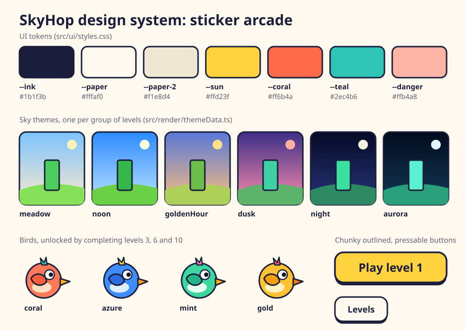

*The board above is generated from `src/ui/styles.css` and `src/render/themeData.ts` by `npm run docs:design`, so it matches the code.*

| Token | Value | Used for |
|---|---|---|
| `--ink` | `#1b1f3b` | Outlines, text, button lip |
| `--paper` / `--paper-2` | `#fffaf0` / `#f1e8d4` | Panels, buttons |
| `--sun` | `#ffd23f` | Primary actions, score highlights |
| `--coral` / `--teal` | `#ff6b4a` / `#2ec4b6` | Bird and accents |
| `--danger` | `#ffb4a8` | Destructive action (reset progress) |

* **Type:** Fredoka variable (rounded, friendly, legible at game sizes).
* **Shape:** 3 px ink outline, 16 px radius, a 5 px "lip" shadow that compresses when pressed.
* **Motion:** springy pop-ins for score and banners, squash and stretch on the bird; everything slows or stops under
  Reduce motion.
* **Brand mark:** the same coral bird, with its teal crest and pink cheek, appears as the launcher icon and the animated
  splash. The icon is drawn once in `scripts/bird-art.mjs`.

| Menu | Get ready | Level complete | Game over |
|---|---|---|---|
| 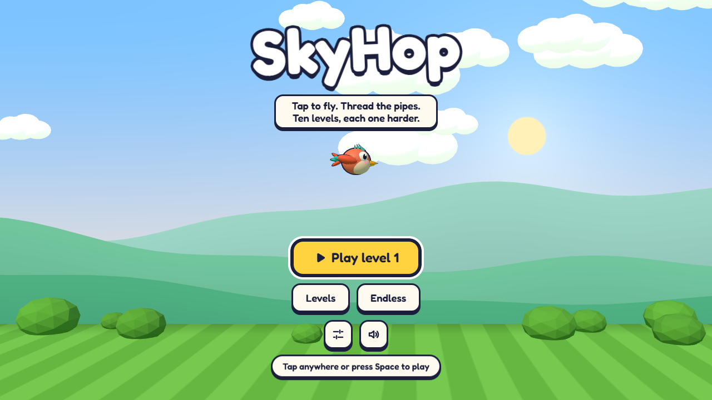 | 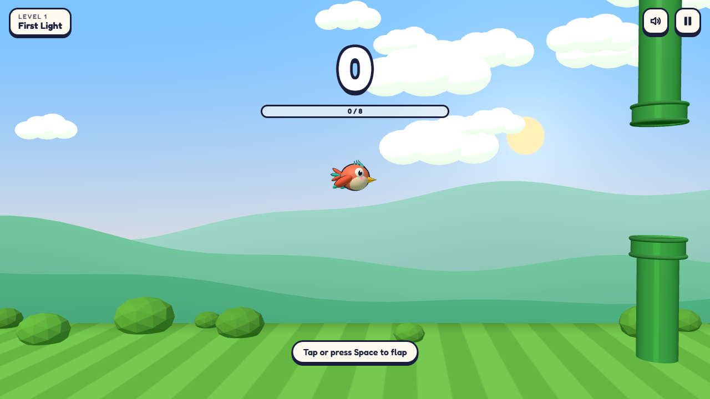 | 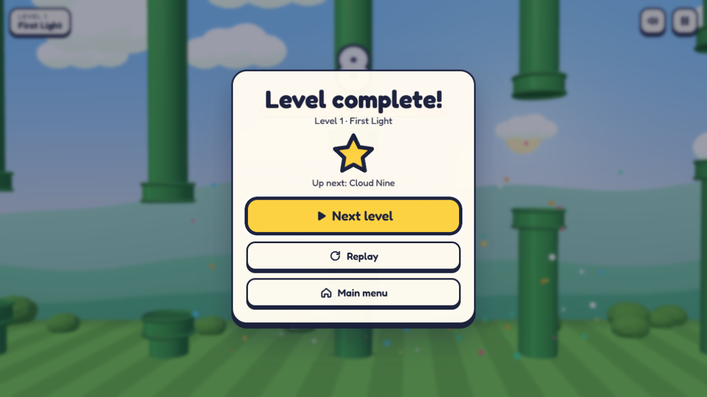 | 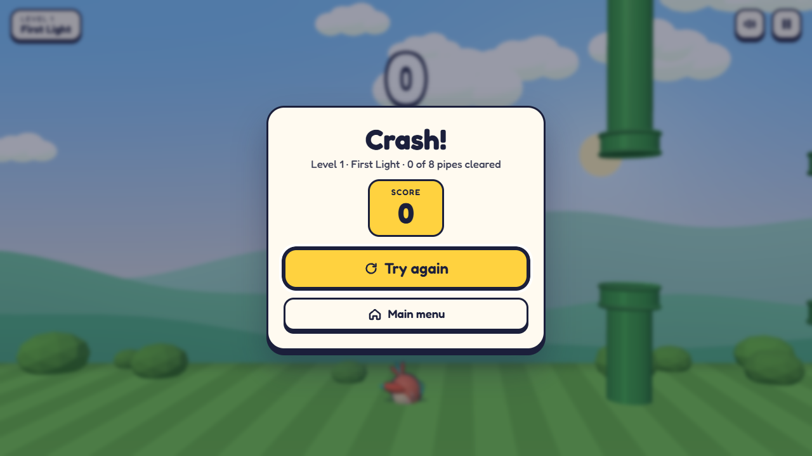 |

| Level select | Settings | Phone | Android menu |
|---|---|---|---|
| 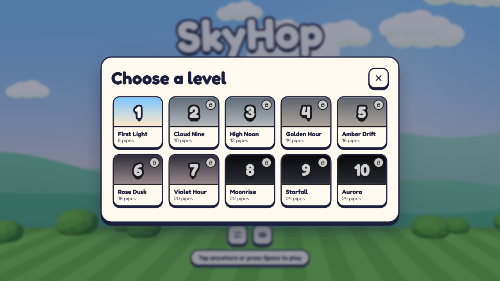 | 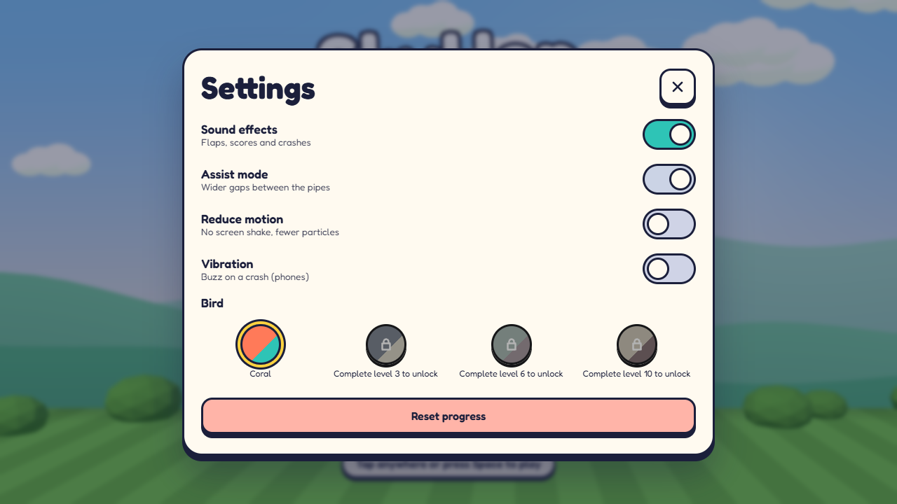 | 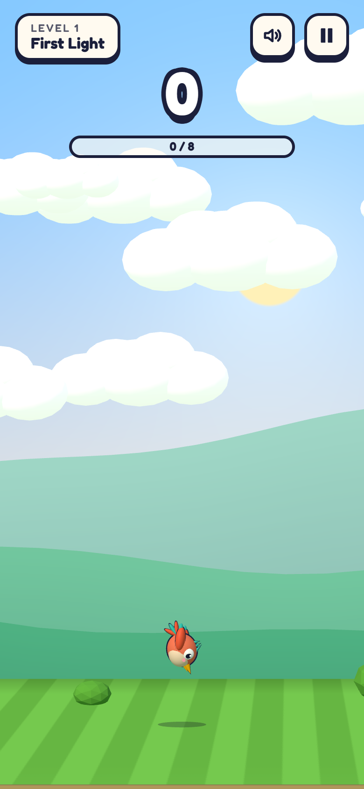 | 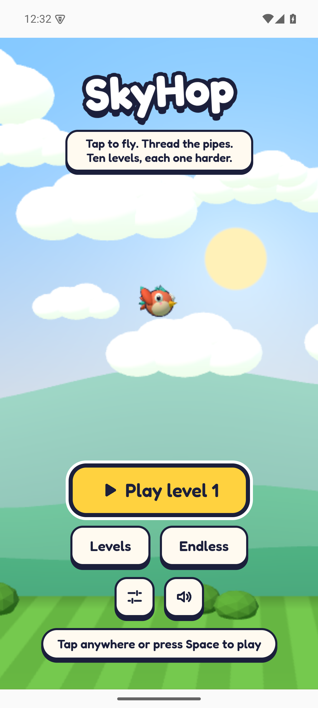 |

| Golden hour | Dusk | Night | Aurora |
|---|---|---|---|
| 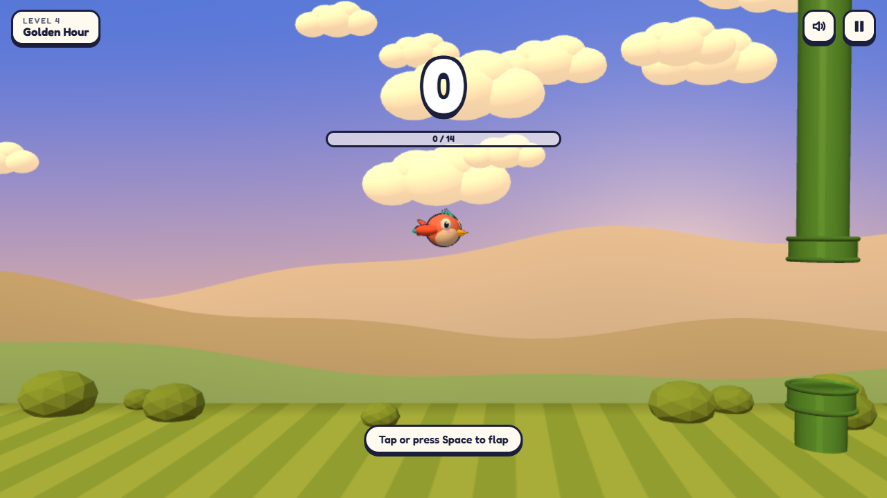 | 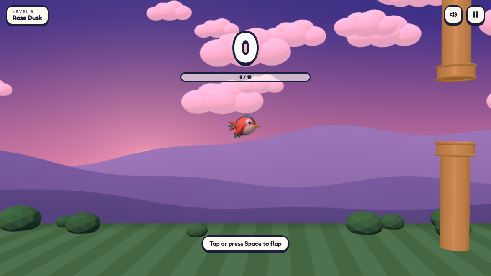 | 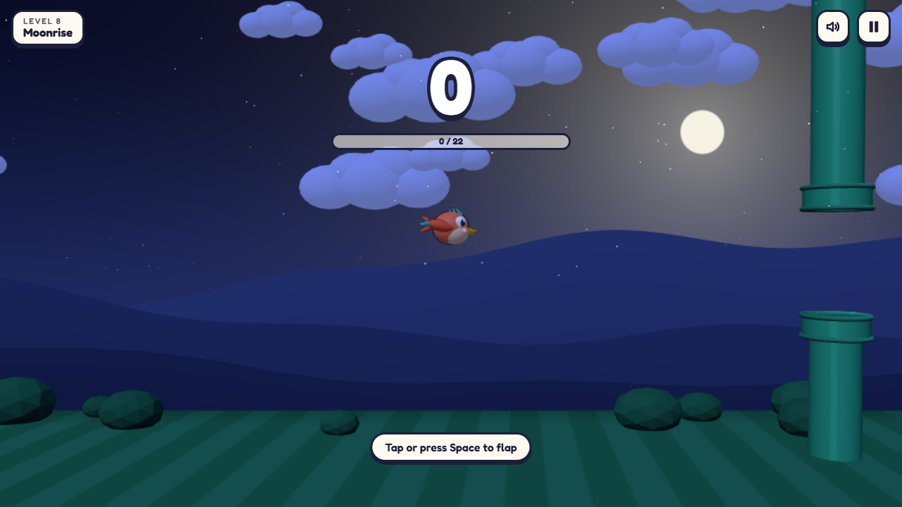 | 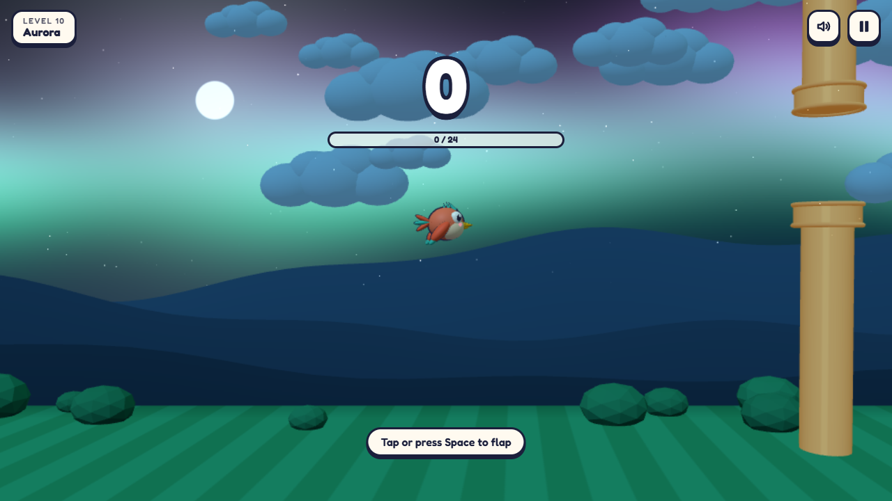 |

## 12. Build, Android and release

### 12.1 From source to APK

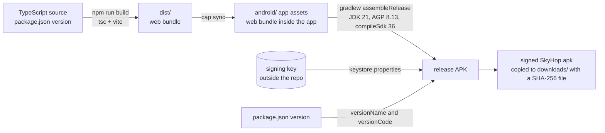

`npm run android:apk` runs the whole chain (`scripts/build-apk.mjs`). The script refuses to publish an unsigned APK because
a phone cannot install one.

### 12.2 The Android app

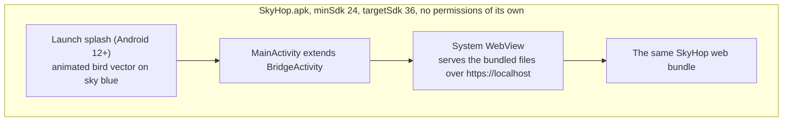

* The web build is copied into the app and served by the WebView itself, so the app works offline and needs no network
  permission (the `INTERNET` permission is deliberately not declared, and a test keeps it that way).
* **Icon:** an adaptive icon made of two layers, the bird and a sky, so launchers can move them against each other. Older
  launchers get static square and round PNGs. Launcher icons cannot be animated by Android.
* **Splash:** on Android 12 and newer, an animated vector (the bird hops and flaps for about 0.9 s) on the sky colour.
* **Version:** `package.json` is the single source. `versionName` is its version and `versionCode` is
  `major x 10000 + minor x 100 + patch`.
* **Pause on app switch:** when the app goes to the background the WebView window loses focus, which triggers the same
  auto-pause as a hidden browser tab.

### 12.3 Continuous integration and releases

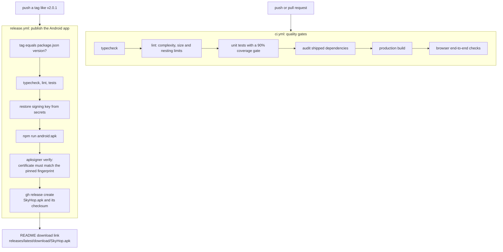

The README link always points at the newest release, so publishing a version is: set `version` in `package.json`, commit,
tag `vX.Y.Z`, push the tag. The release job stops with a clear message if the tag and `package.json` disagree, if a signing
secret is missing, or if the APK was signed with any key other than the pinned one, because phones refuse to update an app
signed with a different key.

## 13. Testing

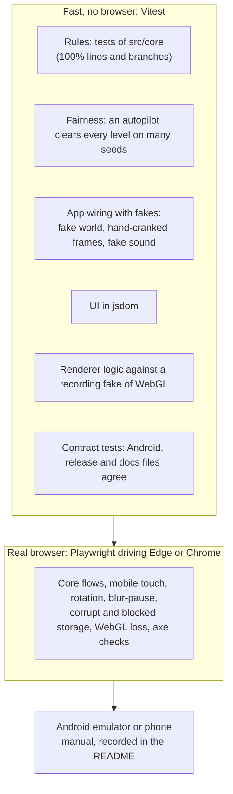

| Suite | Files | What it proves |
|---|---|---|
| Rules | `tests/core-basics.test.ts`, `tests/phase-session.test.ts`, `tests/pipes-collision.test.ts` | Physics, phases, scoring, collision, level curve |
| Fairness | `tests/autopilot.test.ts`, `tests/helpers/autopilot.ts` | No generated layout is unreachable |
| App | `tests/game-app.test.ts`, `tests/app-controls.test.ts`, `tests/presenter.test.ts`, `tests/app-helpers.test.ts`, `tests/helpers/app-rig.ts` | Wiring, input, pause, countdown, level flow, error handling |
| UI | `tests/ui-basics.test.ts`, `tests/ui-screens.test.ts` | Screens, focus trap, dialogs, accessibility attributes |
| Render | `tests/render-logic.test.ts`, `tests/render-objects.test.ts`, `tests/render-stage.test.ts`, `tests/render-world.test.ts` | Framing, models, effects, the world view |
| I/O | `tests/storage.test.ts`, `tests/storage-browser.test.ts`, `tests/input.test.ts`, `tests/sfx.test.ts` | Validation, persistence failures, input mapping, sound |
| Repository | `tests/release-contract.test.ts`, `tests/docs.test.ts` | The Android identity, release workflow, README promises, ignore rules and these docs stay consistent |
| Browser | `tests/e2e/run.mjs`, `tests/e2e/extra.mjs`, `tests/e2e/harness.mjs` | Real input in a real browser, including phone touch and axe |

**Quality gates** (the README lists the latest results): strict type check, ESLint with the project limits (line length 120,
complexity 10, cognitive complexity 15, nesting 3, four parameters, functions under 60 lines), a 90% coverage gate on all
four metrics, `npm audit` on shipped dependencies, and the browser suite.

**What no automated test here can judge:** how the game feels and sounds, real-GPU frame rate, and behaviour on physical
phones. Those are recorded as not verified in the README.

## 14. Decisions and trade-offs

| Decision | Alternative | Why this way |
|---|---|---|
| Three.js, no Phaser | Keep Phaser with sprites | A real 3D bird cannot be faked convincingly with sprites. See the ADR. |
| Pure `core` plus a `WorldPort` | Rules inside the scene | Testable without WebGL, and a bot can prove fairness. |
| Fixed 1/120 s step with interpolation | Frame-rate-dependent physics | The same feel on every display. |
| Generator caps each jump by player ability | Pure random gaps | No impossible layouts; the cap came from a real defect found by the bot. |
| Everything procedural | Art and audio files | No licences to track, tiny download. |
| DOM overlays, no UI framework | React or similar | Small bundle, accessible by construction. |
| Capacitor wraps the web build | Native rewrite | One code base for browser and Android. |
| Releases published from version tags | Committing APKs | Old versions stay downloadable and the repository stays small. |
| Release key outside the repo, pinned in CI | Debug signing | Updates install in place, and a wrong key fails the build. |

## 15. Extending the game

| To add | Change |
|---|---|
| A level | Add a spec (name and theme) to the list in `src/core/levels.ts` and raise the count; `tests/docs.test.ts` will tell you to update the README table. |
| A sky theme | Add the id to `ThemeId` in `src/core/levels.ts`, then a full colour set to `THEMES` in `src/render/themeData.ts`. |
| A bird | Add it to `SKINS` in `src/core/skins.ts` with an unlock level, and a palette in `SKIN_PALETTES`. |
| A sound | Add the name to `SfxName` and a voice to `src/audio/sfx.ts`, then call it from the presenter. |
| A setting | Add it to `Settings` and its default and validation in `src/storage/repository.ts`, a switch in `src/ui/dialogs.ts`, and the handling in `GameApp`. |
| A new screen | Add a `build...` function in `src/ui/screens.ts`, a view type in `src/ui/types.ts`, and a method on `Ui`. |

## 16. Known limits

* Feel and sound have not been judged by a person, and real-GPU frame rate was never measured. Physics numbers are in
  `src/core/config.ts`.
* The Android app has been verified on an emulator, not yet on a physical phone (see the README for the exact list).
* Not built: rebindable controls, background music, a leaderboard, a timed mode, achievements.
* The CI and release workflows have not run on GitHub yet.
* The `M` mute key is ignored while a button has keyboard focus (for example the Play button when the menu first opens),
  because the input layer deliberately leaves keys alone on interactive elements.
