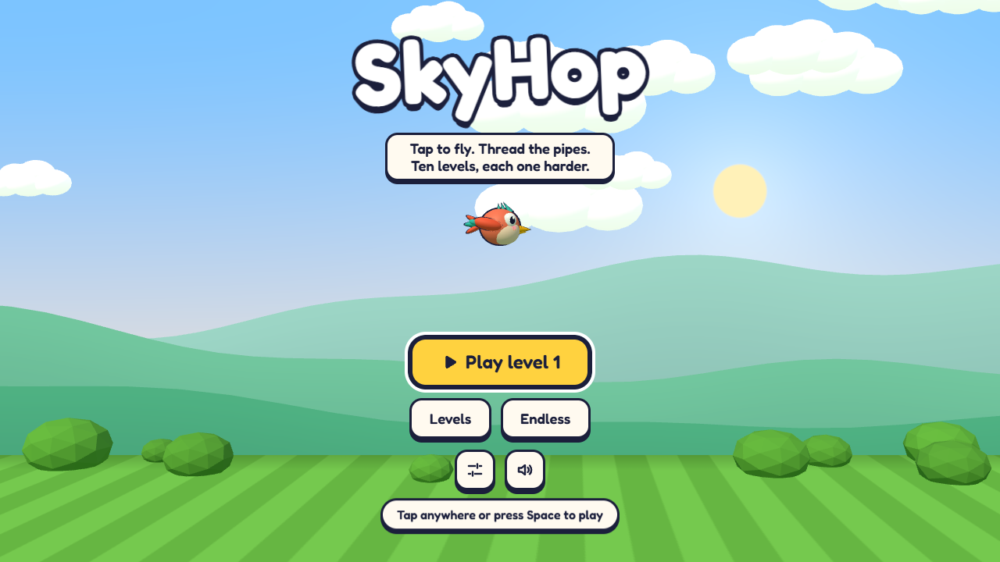
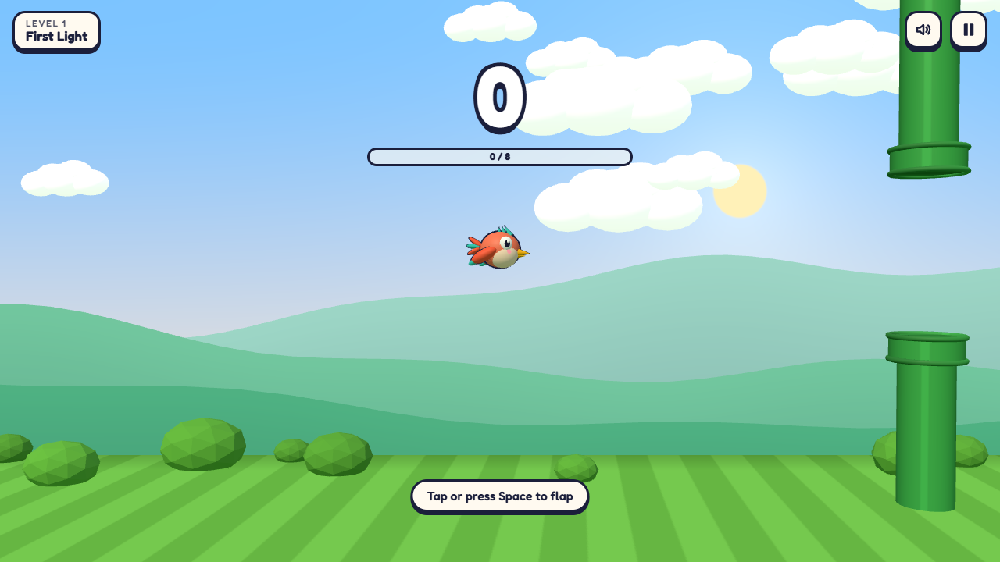
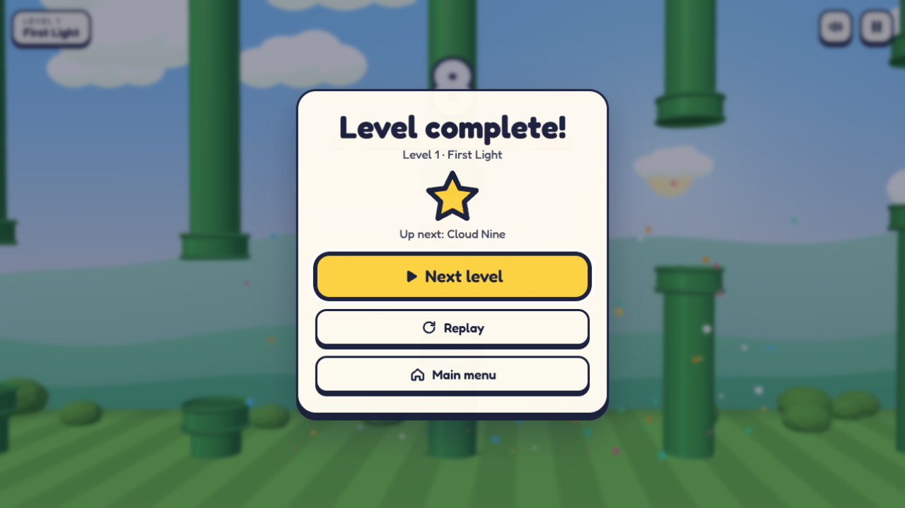
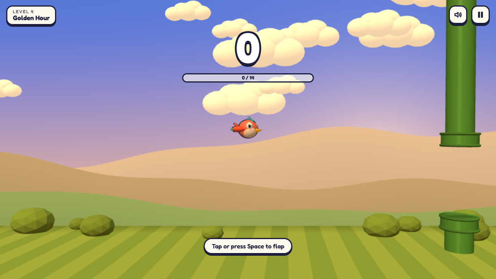
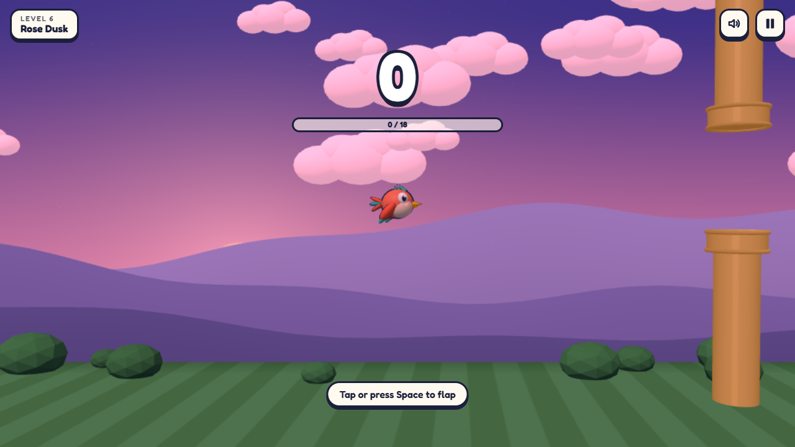
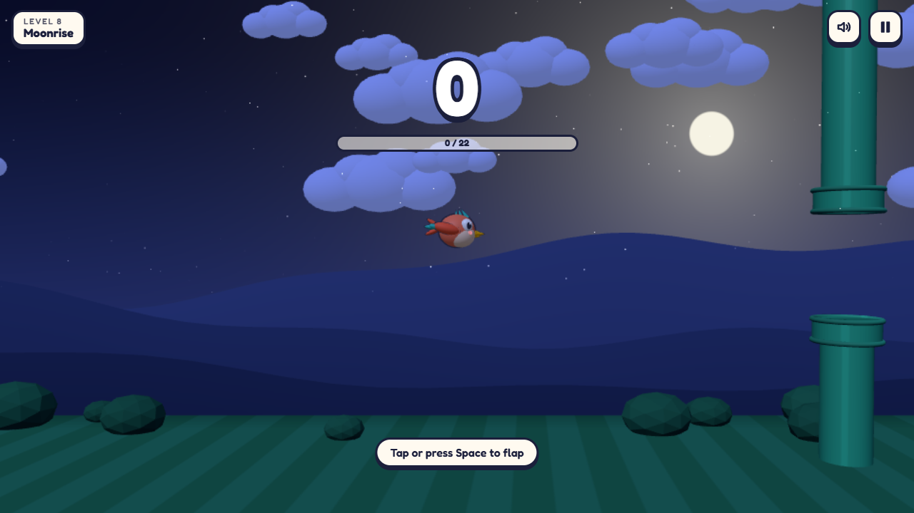
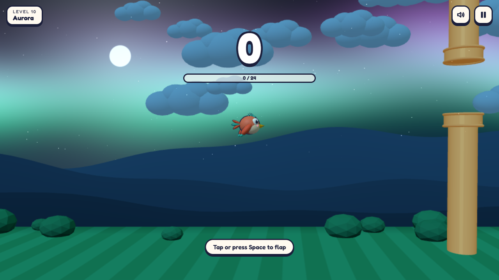
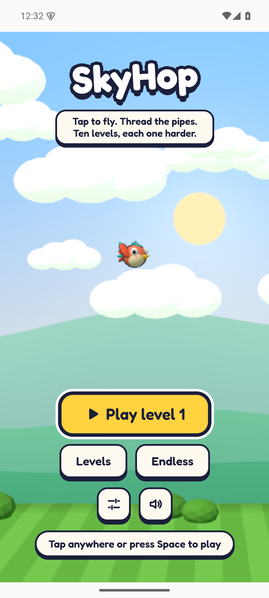
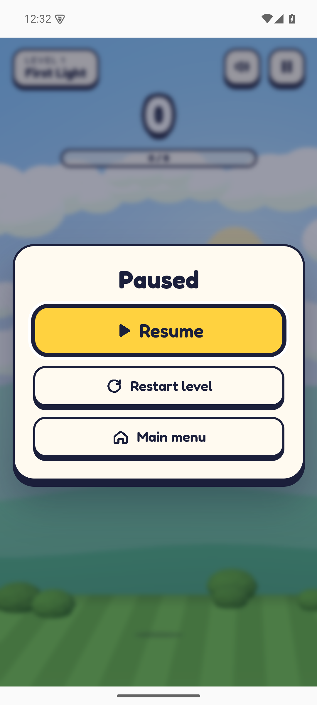

# SkyHop: a 3D tap-to-fly arcade game



Tap to flap, thread the bird through pipes above and below the gap, and survive **ten levels that each get harder**.
It runs in any modern desktop or mobile browser. Open the page, tap, and you are playing.

**Play on Android: [download the latest SkyHop.apk](https://github.com/gopichandchikoti/SkyHop/releases/latest/download/SkyHop.apk)**
(about 3 MB, Android 7.0 or newer, offline, no ads or account). The link always gives the newest version; older ones are on
the [Releases page](https://github.com/gopichandchikoti/SkyHop/releases). Install steps are [below](#android-app).

**How it is built:** see [ARCHITECTURE.md](ARCHITECTURE.md), with diagrams of the layers, game loop, state machine, 3D
rendering, persistence, the Android build and the release pipeline, plus the design system.

| Menu | Get ready | Level complete |
|---|---|---|
|  |  |  |

| Golden hour | Dusk | Night | Aurora |
|---|---|---|---|
|  |  |  |  |

## Run it

```bash
npm install
npm run dev          # http://localhost:5605  (the port is fixed; it fails loudly if it is taken)
```

Production build, served on the same port:

```bash
npm run build
npm run preview      # http://localhost:5605
```

Requires Node 22.12 or newer.

## How to play

| Action | Keyboard | Mouse / touch |
|---|---|---|
| Start, and flap | `Space`, `↑`, `W`, `Enter` | click or tap anywhere in the sky |
| Pause / resume | `Esc` or `P` | pause button |
| Mute | `M` (not while a button has keyboard focus) | sound button |

* **Levels**: ten handcrafted difficulty steps. Finish one to unlock the next. Pick any unlocked level from **Levels**.
* **Endless**: starts at level 1 speed and steps up every 6 pipes until it reaches the level 10 curve. Your best is saved.
* **Assist mode** (Settings): 25% wider gaps.
* **Birds**: Coral is the default. Azure, Mint and Gold unlock when you complete levels 3, 6 and 10.
* The game pauses itself when the tab is hidden or the window loses focus, and resumes with a 3-2-1 countdown.

### The ten levels

Generated from `src/core/levels.ts`, so this table cannot drift from the game.

| # | Name | Sky | Pipes to clear | Speed (u/s) | Gap (u) | Seconds between pipes | Sliding pipes |
|---|------|-----|---------------:|------------:|--------:|----------------------:|---------------|
| 1 | First Light | meadow | 8 | 4.20 | 4.60 | 1.75 | – |
| 2 | Cloud Nine | noon | 10 | 4.48 | 4.42 | 1.68 | – |
| 3 | High Noon | noon | 12 | 4.76 | 4.24 | 1.61 | – |
| 4 | Golden Hour | goldenHour | 14 | 5.04 | 4.06 | 1.54 | – |
| 5 | Amber Drift | goldenHour | 16 | 5.32 | 3.88 | 1.47 | 30% (±0.6 u) |
| 6 | Rose Dusk | dusk | 18 | 5.60 | 3.70 | 1.40 | 40% (±0.7 u) |
| 7 | Violet Hour | dusk | 20 | 5.88 | 3.52 | 1.33 | 50% (±0.8 u) |
| 8 | Moonrise | night | 22 | 6.16 | 3.34 | 1.26 | 60% (±0.9 u) |
| 9 | Starfall | night | 24 | 6.44 | 3.16 | 1.19 | 70% (±1.0 u) |
| 10 | Aurora | aurora | 24 | 6.72 | 2.98 | 1.12 | 80% (±1.1 u) |

1 unit (u) is about one bird-body diameter. **Orange pipes slide up and down**; the game tells you on level 5.
Every layout comes from a seeded generator that caps each vertical jump by what a player can climb (flap rate) or fall
(gravity) in the time between two pipes, so no generated layout is physically unreachable.

## What it is built with

TypeScript, **Three.js** for the 3D scene, Vite, Vitest. There are no art or audio files: the bird, pipes, sky, clouds and
hills are generated in code, and the sound effects are synthesized with the Web Audio API, so there is nothing to
license. The UI font is Fredoka (SIL OFL 1.1) from `@fontsource-variable/fredoka`, bundled and self-hosted.

```
 input (keys / pointer / touch)            ┌──────────────────────────────┐
              │                            │ core/  (pure rules, no DOM)  │
              ▼                            │  GameSession ── PhaseMachine │
        InputController ──► GameApp ──────►│  BirdBody  PipeField  levels │
                              │  ▲         │  collision  FixedStepper rng │
                              │  │ events  └──────────────────────────────┘
              ┌───────────────┼──┴──────────────┬──────────────┐
              ▼               ▼                 ▼              ▼
        PhasePresenter   render/ WorldView   audio/ Sfx   storage/ Repository
        (HUD, dialogs)   (Three.js scene)    (Web Audio)   (localStorage, validated)
```

* **`src/core`**: deterministic rules. Fixed 120 Hz physics step, so speed is identical on 30, 60, 120 and 144 Hz screens.
  A seeded PRNG makes any layout reproducible. No browser APIs, so it is fully unit-testable.
* **`src/render`**: the Three.js world. The camera adapts to portrait and landscape so the ground stays at the bottom.
* **`src/ui`**: DOM overlays built with `createElement` (no `innerHTML`). All text lives in `copy.ts`.
* **`src/app`**: wiring, the frame loop, adaptive render resolution, and persistence of settings and progress.

How the pieces fit together, with diagrams, is in [ARCHITECTURE.md](ARCHITECTURE.md). The stack decision, the design
research, and the visual direction are recorded in
[docs/ADR-0001-stack-and-visual-direction.md](docs/ADR-0001-stack-and-visual-direction.md).

## Quality gates and how to run them

| Check | Command | Result when last run |
|---|---|---|
| Type check (strict) | `npm run typecheck` | passes |
| Lint (line ≤120, complexity ≤10, cognitive ≤15, nesting ≤3, ≤4 params) | `npm run lint` | passes |
| Unit + integration tests, coverage gate 90% | `npm run test:coverage` | 266 tests in 20 files pass. Statements 99.50%, branches 97.23%, functions 99.04%, lines 99.93% |
| Production build | `npm run build` | passes, 618 kB JS (160 kB gzip) |
| Dependency audit, shipped code | `npm audit --omit=dev` | 0 vulnerabilities |
| Real-browser end to end | `npm run dev` then `npm run test:e2e` | 26 pass on the dev server (1 production-only check is skipped there); 20 pass and 7 skip on the production build (`SKYHOP_PROD=1`; the skips need the dev-only debug hook) |
| Android release APK | `npm run android:apk` | builds and is signed (`apksigner` v2 verifies); runs on an Android 15 emulator, see [Android app](#android-app) |

Details worth knowing:

* **Fairness is tested, not assumed.** A simple autopilot must clear every level on 60 seeds per level (plus assist mode
  on the hardest level), and survive 100 pipes of endless mode. A wider one-off sweep (200 seeds × 10 levels × 2 modes) ran 4,000
  levels with 0 failures. This sweep found a real defect during development (no cap on downward jumps) that is now fixed.
* **The end-to-end suite uses real input** (keyboard, mouse and touch) in an installed Edge or Chrome, plays level 1 with
  a bot that only presses `Space`, and runs `axe-core` (its WCAG 2.0 A/AA, 2.1 AA and 2.2 AA rule sets) on the menu, level select,
  settings, level-complete and game-over screens (no violations). axe cannot compute contrast against the live 3D
  background, so the score and hint text that sit over the scene rely on outlines and solid pills and were checked by eye only. It also checks a 320 px phone width and a 568×320 landscape phone.
  Set `SKYHOP_BROWSER` to a browser path if neither is found. Screenshots land in `tests/e2e/output/`.
* The 3D renderer is tested through a recording fake of the WebGL renderer, so the real scene-building code runs. What
  no test can do is judge how the game *feels* or *sounds*; see the limitations below.
* **Where the tests are.** `tests/*.test.ts` is Vitest: the rules, the fairness bot, the app wiring with fakes, the UI in
  jsdom, the renderer, and *contract tests* that keep the Android build, the release workflow, the ignore rules and these
  docs consistent with each other. `tests/e2e/` is Playwright driving a real browser: the core flows in `run.mjs`, and in
  `extra.mjs` phone touch, rotation, pause on losing focus, corrupted and blocked storage, WebGL context loss, saved
  settings and more (shared setup in `harness.mjs`). Run one browser check with
  `SKYHOP_GREP="blocked storage" npm run test:e2e`. The full map is in [ARCHITECTURE.md](ARCHITECTURE.md#13-testing).

## Accessibility, privacy and security

* Every control is a real button or `role="switch"` / `role="radio"`, at least 44×44 px, with a visible focus ring.
  Dialogs trap focus and return it on close. Level and result changes are announced through an `aria-live` region.
* **Reduce motion** (also defaults from your system setting) removes screen shake, shrinks particle bursts and disables
  CSS animation. **Assist mode** widens gaps. Pause on blur. Sliding pipes are tinted orange and also visibly move; a
  tip on level 5 explains them in words.
* Nothing leaves your browser. There is no network call, analytics, account or ad. Progress and settings are stored in
  `localStorage`, validated on every read, and survive corruption or blocked storage (the menu says so when progress
  cannot be saved). **Reset progress** in Settings erases it.
* UI text is inserted as text nodes, never parsed as HTML. The `window.__skyhop` debugging hook exists only in the dev
  server and is stripped from the production bundle.

## Performance

* A light scene: merged geometry, one instanced mesh for all particles, no shadow maps or post-processing, and the device
  pixel ratio is capped at 2. (Draw calls were not instrumented, so there is no number to quote.)
* An adaptive governor lowers render resolution (2 → 1.5 → 1 → 0.75) when frames come slowly. It only steps down, so it
  cannot oscillate.
* Measured here: the game's own JavaScript costs about **3–5 ms per frame** (Chrome DevTools Protocol, headless Edge),
  against a 16.7 ms budget for 60 fps. **Real GPU frame rate was not measured**: this machine's headless browser has no
  GPU, so it rasterizes on the CPU (11–13 fps), which says nothing about your hardware.

## Android app

**[Download the latest SkyHop.apk](https://github.com/gopichandchikoti/SkyHop/releases/latest/download/SkyHop.apk)** ·
about 3 MB · Android 7.0 (API 24) or newer · works offline · no ads, account or network access.

Each new version is published automatically as a [GitHub release](https://github.com/gopichandchikoti/SkyHop/releases)
(see [Publish a new version](#publish-a-new-version)), so this link always serves the newest one. Until the first release
exists, it shows "Not found".

The app is the same game wrapped with [Capacitor](https://capacitorjs.com) 8: the web build is bundled inside the APK and
runs in the system WebView. The native project is in [`android/`](android/).

| Menu | Paused after switching apps |
|---|---|
|  |  |

Both captured from this release APK on an Android 15 emulator.

### Install on your phone

1. Open this page on your phone and tap the download link above. (Or build the APK yourself, below, and copy it over by
   USB or cloud storage.)
2. Open the downloaded file. Android asks you to allow installs from that source (your browser or the Files app). Allow
   it once.
3. If Google Play Protect says the app is from an unrecognized developer, choose **More details**, then **Install
   anyway**. Every app that does not come from the Play Store shows this. This one is signed with the key below.
4. Open **SkyHop** and tap to play.

Settings and progress stay on the device. Uninstalling the app removes them.

### Check the download (optional)

* **Checksum.** Every release also has a `SkyHop.apk.sha256` file holding the APK's SHA-256. Download both into one
  folder and run `sha256sum -c SkyHop.apk.sha256` there (macOS: `shasum -a 256 -c SkyHop.apk.sha256`), or on Windows
  `Get-FileHash SkyHop.apk -Algorithm SHA256` and compare the hash by eye.
* **Signing key.** The release is signed with a key whose certificate SHA-256 is
  `E4:85:19:BE:DD:C7:A8:B9:E7:F2:AA:42:43:6A:4D:CD:EA:D9:44:46:21:AA:C6:97:C5:44:97:02:1B:5F:E9:77`. Compare it with the
  output of `apksigner verify --print-certs SkyHop.apk` (part of the Android SDK build-tools).

### What was and was not verified

Checked on the release APK built locally for version 2.0.0:

* `apksigner`: APK Signature Scheme v2 verifies, one signer, and the certificate is the one listed above.
* `aapt2`: package `com.portfolio.skyhop`, versionCode 20000, minSdk 24, targetSdk 36, not debuggable. The `INTERNET`
  permission is not declared. The only declared permission is an AndroidX-internal one that applies to the app itself;
  Android never asks you to grant it.
* On an Android 15 emulator (Pixel 6 profile, System WebView 124, software-rendered): the app installs and cold-starts,
  draws the 3D menu with the bundled font, accepts real touch input, starts a run, shows the Crash and Paused dialogs,
  pauses by itself when sent to the background with Home, and keeps a setting (sound off) across a force-stop and
  relaunch. Logcat for the app's process shows no JavaScript, WebGL or missing-asset errors.
* The new launcher icon (the coral bird on a sky, as a circular adaptive icon) shows in the Android 15 launcher, and the
  system launch splash draws the bird vector on the sky colour. The APK was rebuilt after the icon and bird-centring
  changes with an identical SHA-256, and re-installed and launched on the emulator.

**Not verified:**

* **No physical phone has run it yet.** Real-GPU frame rate, touch feel and how it sounds are unmeasured (the emulator ran
  without audio and with a software renderer).
* Scoring and level progression were not played through on the device. They are covered by the unit tests and the
  desktop browser suite; the emulator taps were not a skilled player.
* Landscape, phones with a camera cutout, and Android versions other than 15.
* **The splash animation itself.** The splash is defined as an animated vector (the bird hops and flaps for about 0.9 s,
  Android 12 and newer), and it is compiled into the APK, but only one splash frame could be captured on the emulator, so
  the movement was not observed. Android launcher icons themselves cannot animate.
* The game is not drawn edge to edge: Android shows solid system bars above and below it.
* **The release workflow has not run on GitHub yet.** Its tag-versus-`package.json` check, the signing-key restore from a
  base64 secret, and the signature check were each run locally (including a wrong key being rejected), but the Linux
  runner build itself was not. APKs published by it are built in CI and are not emulator-tested automatically.

### Build it yourself

You need Node 22.12+, **JDK 21** (what the published APK was built with), and the Android SDK with platform 36 and
build-tools (Android Studio installs them), with `ANDROID_HOME` set or an `android/local.properties` containing
`sdk.dir=...`.

1. Create a signing key once. Keep it **outside the repo** and back it up: Android refuses to update an app with a
   different key, so a lost key means everyone must uninstall first.

   ```bash
   keytool -genkeypair -alias skyhop -keyalg RSA -keysize 2048 -validity 10000 -storetype PKCS12 \
     -keystore /path/outside/repo/skyhop-release.jks
   ```

2. Create `android/keystore.properties` (git-ignored, never commit it):

   ```properties
   storeFile=/path/outside/repo/skyhop-release.jks
   storePassword=...
   keyAlias=skyhop
   keyPassword=...
   ```

3. Build:

   ```bash
   npm run android:apk      # web build, cap sync, Gradle assembleRelease, copy to downloads/ (git-ignored)
   ```

   The script refuses to publish an unsigned APK, because a phone cannot install one. To work in Android Studio instead,
   run `npm run android:sync` and then `npx cap open android`. `npm run android:icons` redraws the launcher icons.

The app version is the `version` in `package.json` (`versionCode` = major × 10000 + minor × 100 + patch). Rebuilding
changes the APK's checksum; `downloads/SkyHop.apk.sha256` is rewritten for you.

### Publish a new version

Pushing a version tag builds the signed APK on GitHub and publishes it as a release
([`.github/workflows/release.yml`](.github/workflows/release.yml)). The download button above then serves it.

**One-time setup:** add four repository secrets under *Settings, Secrets and variables, Actions, New repository secret*.
The commands copy each value to your clipboard from PowerShell (run them in the repo root), so a secret is never printed
on screen. Use the same key as the first release, or phones that have the app cannot update it.

| Secret | Value | Copy it with |
|---|---|---|
| `ANDROID_KEYSTORE_BASE64` | the key file, base64 | `[Convert]::ToBase64String([IO.File]::ReadAllBytes("$env:USERPROFILE\.skyhop-signing\skyhop-release.jks")) \| Set-Clipboard` |
| `ANDROID_KEYSTORE_PASSWORD` | `storePassword` from `android/keystore.properties` | `(Get-Content android\keystore.properties \| Where-Object { $_ -like 'storePassword=*' }) -replace '^storePassword=','' \| Set-Clipboard` |
| `ANDROID_KEY_ALIAS` | `skyhop` | type it |
| `ANDROID_KEY_PASSWORD` | `keyPassword` from `android/keystore.properties` | `(Get-Content android\keystore.properties \| Where-Object { $_ -like 'keyPassword=*' }) -replace '^keyPassword=','' \| Set-Clipboard` |

**Each release:**

```bash
# 1. Set "version" in package.json to the new number (for example 2.0.1) and commit it.
# 2. Tag that commit with the same number and push the tag.
git tag v2.0.1
git push origin main v2.0.1
```

The job takes a few minutes (watch it in the repo's **Actions** tab). It stops with a clear message if the tag does not
equal `package.json`'s version, if a secret is missing, or if the APK was not signed with the expected key (its
certificate SHA-256 is pinned as `EXPECTED_CERT_SHA256` in `release.yml`; change it only if you deliberately replace the
key). A tag can be used once, so use the next number for each release. The very first release is `v2.0.0`.

## Troubleshooting

| Symptom | Fix |
|---|---|
| `Port 5605 is already in use` | Another process holds the port. Find it with `netstat -ano \| findstr :5605`, then stop only that PID. The port is fixed on purpose (`strictPort`). |
| "The sky is unavailable" | The browser could not start WebGL. Enable hardware acceleration or try another browser. |
| Progress will not save | Storage is blocked (private window or strict privacy). The game still plays; the menu shows a notice. |
| `npm run test:e2e` finds no browser | Install Edge or Chrome, or set `SKYHOP_BROWSER` to a Chromium executable. |
| Phone says "App not installed" | An older SkyHop signed with a different key is installed. Uninstall it, then install again. |
| `npm run android:apk` fails before Gradle | Needs `android/keystore.properties` for signing; without it Gradle builds an unsigned APK and the script stops on purpose. |
| Release job: "Tag ... does not match package.json" | Set `version` in `package.json` to the tag's number, commit, delete the wrong tag (`git tag -d vX.Y.Z`, `git push origin :refs/tags/vX.Y.Z`) and tag again. |
| Release job: "Repository secret ... is missing" | Add the four `ANDROID_*` secrets, see [Publish a new version](#publish-a-new-version). |
| Download link says "Not found" | No release exists yet. Push the first version tag (`v2.0.0`). |
| Gradle complains about the Java version | The APK was built with JDK 21 (older JDKs were not tried). Point `JAVA_HOME` at a JDK 21. |

## Known limitations and next steps

* **Feel and sound were not play-tested by a person.** Physics were tuned with an autopilot and the numbers are in
  `src/core/config.ts` (`gravity`, `flapVelocity`, hitbox radius). Audio is verified only against a fake `AudioContext`;
  nobody has listened to it. Please play a few levels and tell me what to tune.
* Controls are not rebindable yet (the SPEC lists this); several default keys are supported instead.
* The `M` mute key does nothing while a button has keyboard focus, which includes the Play button when the menu first
  opens (checked in a real browser). The sound button and the key during play both work.
* No background music, leaderboard, timed-challenge mode or achievements. Cosmetic birds are unlocked by progress.
* The CI workflow in `.github/workflows/ci.yml` has not been run on GitHub.
* The 15 remaining `npm audit` findings are all moderate and all in developer tooling (the ESLint tree, and a transitive
  `rimraf` inside the Capacitor CLI); shipped code has none. Upgrading Capacitor 6 to 8 removed the critical `tar` and the
  high CLI advisories.
* The release workflow (`release.yml`) has never run on GitHub, and neither has `ci.yml`. Expect one round of fixes on
  the first run. Regular pushes run `ci.yml` only; releases happen only when a version tag is pushed.

The original product spec is in [SPEC.md](SPEC.md); the change history is in [FEATURE_LOG.md](FEATURE_LOG.md).
